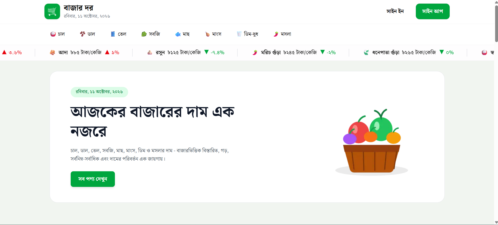
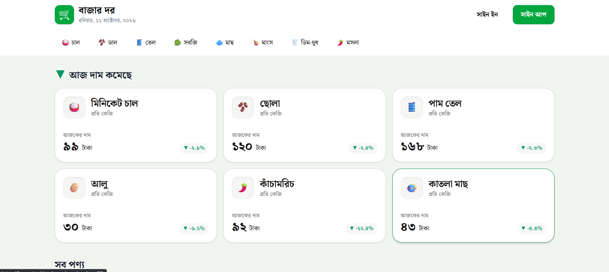
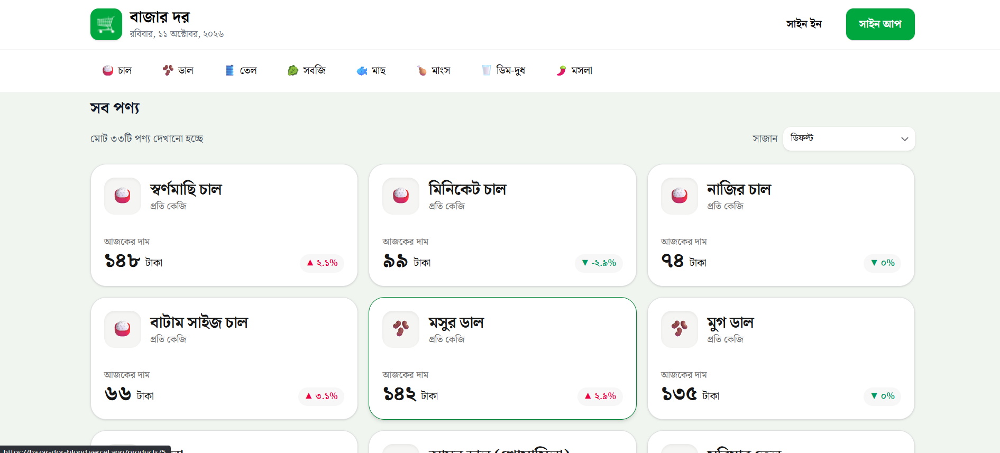
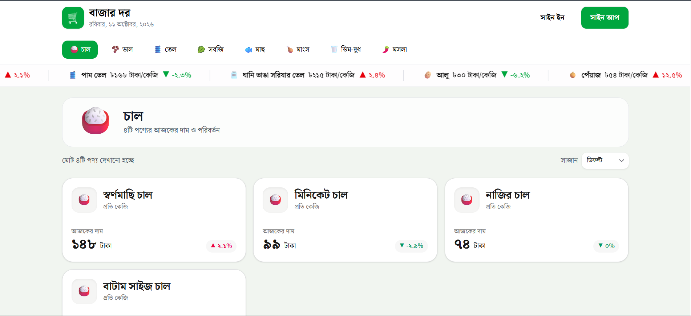
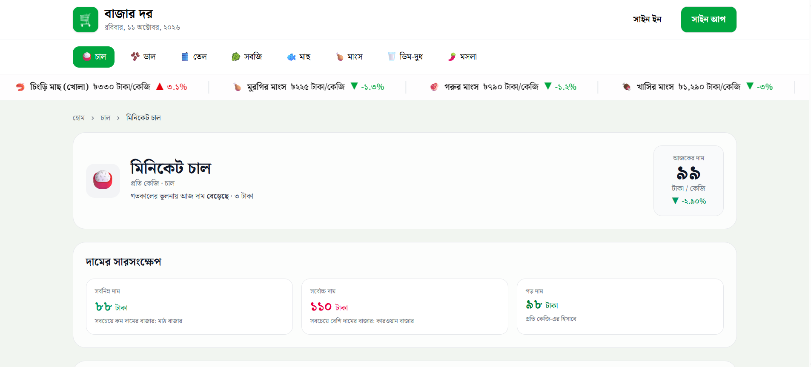
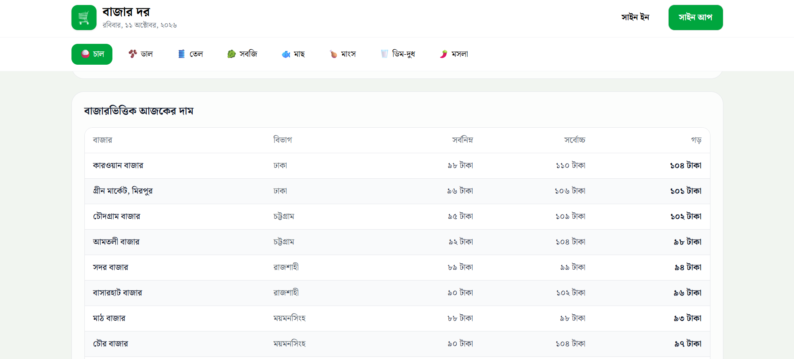
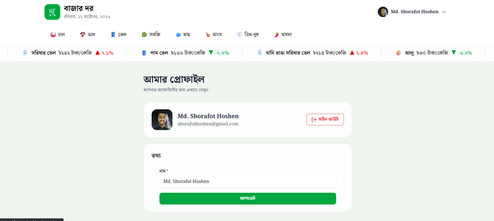

<div align="center">

# 🛒 বাজার দর (BazarDor)

**প্রয়োজনীয় পণ্যের দাম এক নজরে**

চাল, ডাল, তেল, সবজি, মাছ, মাংস, ডিম ও মসলার আজকের দাম, বাজারভিত্তিক তুলনা এবং দামের পরিবর্তন এক জায়গায়।

[🌐 Live Demo](https://bazar-dor-blond.vercel.app/)

</div>

---

## 📖 প্রজেক্ট পরিচিতি

**বাজার দর** একটি বাংলা ভাষার পণ্যমূল্য তথ্য ওয়েব অ্যাপ। এখানে বাংলাদেশের বিভিন্ন বাজারের প্রতিদিনের পণ্যের দাম দেখা যায়। ব্যবহারকারী ক্যাটাগরি অনুযায়ী পণ্য খুঁজতে পারেন, দাম বাড়া-কমা দেখতে পারেন, আর সাইন ইন করে প্রতিটি পণ্যের সর্বনিম্ন, সর্বোচ্চ ও গড় দামসহ বাজারভিত্তিক বিস্তারিত তালিকা দেখতে পারেন।

প্রজেক্টটি মোবাইল, ট্যাবলেট ও ডেস্কটপ, সব স্ক্রিনে সুন্দরভাবে চলে।

---

## ✨ প্রধান ফিচার

- 🔝 **Sticky Navbar ও লাইভ প্রাইস টিকার:** বাংলা তারিখ, ক্যাটাগরি লিংক, আর navbar-এর নিচে অনবরত চলমান দামের marquee (ইমোজি, নাম, দাম, ▲/▼ %)
- 📈 **দাম বাড়া ও কমার সেকশন:** হোম পেজে আজ যে পণ্যের দাম সবচেয়ে বেশি বেড়েছে ও কমেছে, তার আলাদা তালিকা
- 🗂️ **ক্যাটাগরি পেজ ও সাজান (Sort):** ক্যাটাগরি অনুযায়ী পণ্য দেখা, আর "ডিফল্ট / দাম: কম থেকে বেশি / দাম: বেশি থেকে কম" অনুযায়ী সাজানো
- 🔐 **Authentication:** Email/Password, Google ও GitHub দিয়ে সাইন ইন ও সাইন আপ (BetterAuth)
- 🛡️ **Protected Route:** লগইন ছাড়া পণ্যের বিস্তারিত পেজে ঢোকা যায় না, সাইন ইন পেজে পাঠিয়ে দেওয়া হয়
- 📊 **পণ্যের বিস্তারিত পেজ:** সর্বনিম্ন, সর্বোচ্চ ও গড় দাম, সাথে বিভাগভিত্তিক সব বাজারের দামের টেবিল
- 👤 **প্রোফাইল ম্যানেজমেন্ট:** ব্যবহারকারীর ছবি, নাম, ইমেইল দেখা, নাম আপডেট করা ও সাইন আউট
- 🔔 **Toast Notification:** সাইন ইন, সাইন আপ, আপডেট ও ত্রুটির জন্য তাৎক্ষণিক বার্তা
- ⏳ **Loading Skeleton ও 404 পেজ:** ডেটা আসার সময় skeleton, আর ভুল ঠিকানায় বন্ধুত্বপূর্ণ 404 পেজ
- 🔢 **বাংলা সংখ্যা:** সব দাম ও পরিমাণ বাংলা অঙ্কে (যেমন `১৪৮ টাকা`)
- 📱 **সম্পূর্ণ Responsive:** মোবাইল, ট্যাবলেট ও ডেস্কটপে সঠিকভাবে কাজ করে

---

## 🖼️ স্ক্রিনশট

### 🏠 হোম পেজ






### 🗂️ ক্যাটাগরি পেজ



### 📊 পণ্যের বিস্তারিত পেজ




### 👤 প্রোফাইল




---

## 🛠️ ব্যবহৃত প্রযুক্তি

| প্রযুক্তি | কাজ |
|---|---|
| [Next.js](https://nextjs.org/) (App Router) | UI তৈরি, রাউটিং, Server Components |
| [TypeScript](https://www.typescriptlang.org/) | টাইপ-নিরাপদ কোড |
| [Tailwind CSS](https://tailwindcss.com/) | স্টাইলিং ও responsive ডিজাইন |
| [HeroUI](https://www.heroui.com/) | ফর্ম, বাটন, ড্রপডাউনের মতো UI কম্পোনেন্ট |
| [BetterAuth](https://www.better-auth.com/) | Email/Password, Google ও GitHub authentication |
| [MongoDB](https://www.mongodb.com/) | ব্যবহারকারী ও সেশনের ডেটা সংরক্ষণ |
| [React Toastify](https://fkhadra.github.io/react-toastify/) | Toast notification |
| [React Icons](https://react-icons.github.io/react-icons/) | আইকন |
| [Vercel](https://vercel.com/) | Deployment |

---

## 🔌 API

ডেটা নেওয়া হয়েছে এই API থেকে:

```
BASE URL: https://openapi.programming-hero.com
```

| Endpoint | কাজ |
|---|---|
| `/products` | সব পণ্য |
| `/products?category=chal` | ক্যাটাগরি অনুযায়ী পণ্য |
| `/products/1` | একটি পণ্য |
| `/categories` | সব ক্যাটাগরি |
| `/categories/chal` | একটি ক্যাটাগরি |

---

## 🚀 কীভাবে লোকালে চালাবেন

**১. রিপোজিটরি ক্লোন করুন**

```bash
git clone https://github.com/shorafothoshen/Bazar-Dor
cd bazar-dor
```

**২. প্যাকেজ ইনস্টল করুন**

```bash
npm install
```

**৩. Environment Variable সেট করুন**

প্রজেক্টের root-এ `.env.local` নামে একটি ফাইল বানিয়ে নিচের মানগুলো বসান:

```env
# API
NEXT_PUBLIC_ANALYTICS_BASE_URL=https://openapi.programming-hero.com

# Database
MONGODB_CONNECTION_BASE_URL=your_mongodb_connection_string

# BetterAuth
BETTER_AUTH_SECRET=your_random_secret
BETTER_AUTH_URL=http://localhost:3000

# Google Login
BETTER_AUTH_GOOGLE_CLIENT_ID=your_google_client_id
BETTER_AUTH_GOOGLE_CLIENT_SECRET=your_google_client_secret

# GitHub Login
BETTER_AUTH_GITHUB_CLIENT_ID=your_github_client_id
BETTER_AUTH_GITHUB_CLIENT_SECRET=your_github_client_secret
```

**৪. ডেভেলপমেন্ট সার্ভার চালু করুন**

```bash
npm run dev
```

ব্রাউজারে খুলুন: [http://localhost:3000](http://localhost:3000)


## 📌 নোট

- সকল দাম সম্ভাব্য; বাজার অবস্থার ওপর নির্ভর করে পরিবর্তিত হয়।
- Google ও GitHub লগইন কাজ করার জন্য সংশ্লিষ্ট ডেভেলপার কনসোলে callback URL (`/api/auth/callback/google` ও `/api/auth/callback/github`) যোগ করতে হবে।

---
